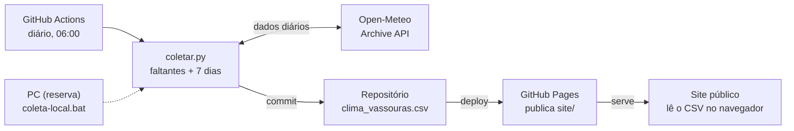

# PRD — Refactor ClimaVassouras

19/10/2026 · Sergio

> **Cópia de 19/10/2026.** A versão viva, com comentários e o diagrama interativo, está no Claude Docs:
> https://claude.ai/code/artifact/3c303687-6eed-471a-b059-999e8cdbd11c
> Se as duas divergirem, vale a do Claude Docs; atualize esta cópia ao fechar cada fase.

## Resumo e contexto

O refactor transforma o ClimaVassouras de um script local frágil em um painel climático público e confiável. A captura passa a rodar sem depender do PC, o histórico começa em 01/01/2020 e o dashboard ganha quatro novas visões.

**Hoje:** o Agendador do Windows roda um `.bat` uma vez por dia. O `.bat` chama `clima_vassouras.py`, que busca o dia anterior na API Open-Meteo, grava o CSV e faz commit e push do CSV. A Netlify, que hoje não está ligada a nenhum repositório do GitHub, publica um `index.html` que lê esse CSV e mostra cards, dois gráficos e uma tabela do mês.

**Por que refatorar:**

- Dias perdidos nunca são recuperados: o script só busca "ontem".
- A falha 503 de 17/10/2026 veio de uma chamada à API feita só para descobrir a data de hoje.
- O dashboard tem bugs visíveis: no dia 1º de cada mês abre em abril de 2026, e um mês sem dados mantém os números do mês anterior na tela.
- O código está espalhado: pasta oculta `.llm/`, quatro cópias do CSV, um repositório Git dentro de outro e cópia manual para `D:\CapturaClima`.
- O público passa a ser geral, o que exige uso no celular, acessibilidade e a data da última atualização visível.

## Objetivos e não-objetivos

**Objetivos**

1. **Dados completos:** nenhum dia faltando no histórico de 01/01/2020 até ontem, mesmo quando uma execução falha.
2. **Captura sem depender do PC:** GitHub Actions como execução principal e o PC como reserva, sem conflito entre os dois.
3. **Uma fonte da verdade:** um CSV, um script Python, um repositório e nenhuma cópia manual.
4. **Dashboard correto e público:** corrigir os quatro bugs conhecidos, mostrar a data do último dado e funcionar bem no celular.
5. **Mais contexto climático:** 10 cards, condição do dia, sensação térmica e quatro visões novas (Ano, Comparar, Recordes, Calendário).

**Não-objetivos**

- Normal climatológica oficial (1991–2020): o histórico começa em 2020, então a referência é a média 2020–2025.
- Previsão do tempo, alertas e outras cidades.
- Banco de dados ou backend: o CSV continua sendo o armazenamento.
- Etapa de build no front-end (Vite, React).
- Mudar os gráficos de Evolução Térmica e de Precipitação & Vento.

## Público e casos de uso

O dashboard é para o público geral: quem abre o site pelo celular quer uma resposta rápida, sem saber nada de meteorologia.

| Quem | Pergunta que quer responder | Onde responde |
| --- | --- | --- |
| Morador | Quanto choveu este mês? Fez mais calor que o normal? | Aba Mês: cards de chuva, dias quentes e sensação térmica |
| Produtor rural | Este ano está mais seco que os anteriores? | Aba Ano: chuva mês a mês contra a média 2020–2025 |
| Imprensa local | Este outubro foi o mais chuvoso desde quando? | Aba Recordes e aba Comparar |
| Prefeitura / Defesa Civil | Quais dias tiveram chuva forte ou calor extremo? | Aba Calendário e tabela do mês |
| Mantenedor (você) | A captura de hoje funcionou? | Data do último dado no cabeçalho, log e histórico do GitHub Actions |

## Requisitos de captura de dados

Um único script, `coletar.py`, substitui `clima_vassouras.py` e `Historico_clima_vassouras.py`. Rodar o script duas vezes seguidas deixa o CSV igual: é isso que permite a execução híbrida sem conflitos.

| ID | Requisito | Detalhe |
| --- | --- | --- |
| C1 | Recuperar dias faltantes | A cada execução, busca todos os dias entre o último registro do CSV e ontem, numa única chamada à API. |
| C2 | Rebuscar dias recentes | Rebusca também os últimos 7 dias e sobrescreve o que mudou, para pegar revisões da API. |
| C3 | Data de hoje sem API | "Hoje" vem de `datetime.now(ZoneInfo("America/Sao_Paulo"))`. A chamada à API forecast sai. |
| C4 | Nova tentativa | 3 tentativas com espera crescente (5 s, 15 s, 45 s) para erros 5xx, 429 e de rede. |
| C5 | Dia ainda indisponível | Se a API ainda não tem o dado de ontem, o script grava o que tem e termina sem erro. O dia entra na próxima execução. |
| C6 | Validação | Recusa gravar se faltar uma variável num dia, se houver datas repetidas ou se a mínima for maior que a máxima. |
| C7 | Gravação segura | Arquivo `.tmp` + `replace`, e o `.tmp` é apagado se der erro. |
| C8 | Parâmetros | `--de AAAA-MM-DD` e `--ate AAAA-MM-DD` para carga ou reprocessamento. Sem parâmetros, faz a rotina diária (C1 + C2). |
| C9 | Configuração fora do código | Coordenadas, fuso, caminho do CSV e dias de revisão num `config.toml` ou num bloco de constantes único. |
| C10 | Código de saída | 0 = sucesso (com ou sem mudança), 1 = erro. Mensagens em UTF-8. |
| C11 | Carga inicial | Uma execução `--de 2020-01-01` preenche o histórico com as 3 variáveis novas (cerca de 2.480 dias). |

**Execução híbrida**

- **GitHub Actions (principal):** um workflow agendado para as 06:00 de Brasília (09:00 UTC) roda `coletar.py` e faz commit do CSV só se ele mudou e, no mesmo workflow, publica o site no GitHub Pages. Também pode ser disparado à mão (`workflow_dispatch`).
- **PC (reserva):** um `.bat` curto faz `git pull --rebase`, roda o script e faz commit e push só se houve mudança. Se o rebase der conflito, descarta a alteração local, puxa de novo e roda o script outra vez.
- **Avisos:** se o workflow falhar, o GitHub manda e-mail ao dono do repositório (recurso nativo, sem configuração extra).

## Modelo de dados

Um único CSV, `dados/clima_vassouras.csv`, é a fonte da verdade, de 01/01/2020 até ontem. Formato: UTF-8 com BOM, separador `;`, decimal com vírgula, datas ISO (`2026-10-18`), uma linha por dia em ordem crescente. Assim continua abrindo direto no Excel em português.

| Coluna | Variável Open-Meteo | Unidade | Status |
| --- | --- | --- | --- |
| `data` | `time` | AAAA-MM-DD | Atual |
| `temperatura_minima` | `temperature_2m_min` | °C | Atual |
| `temperatura_maxima` | `temperature_2m_max` | °C | Atual |
| `chuva_mm` | `precipitation_sum` | mm | Atual |
| `umidade_media` | `relative_humidity_2m_mean` | % | Atual |
| `vento_maximo_kmh` | `wind_speed_10m_max` | km/h | Atual |
| `condicao` | `weather_code` | código WMO (inteiro) | **Nova** |
| `sensacao_minima` | `apparent_temperature_min` | °C | **Nova** |
| `sensacao_maxima` | `apparent_temperature_max` | °C | **Nova** |
| `origem` | — | texto | Atual |

O CSV guarda o código WMO numérico; o dashboard converte o código em ícone e texto:

| Códigos WMO | Condição exibida |
| --- | --- |
| 0–1 | Ensolarado |
| 2 | Parcialmente nublado |
| 3 | Nublado |
| 45, 48 | Nevoeiro |
| 51–57 | Garoa |
| 61–67, 80–82 | Chuva |
| 95–99 | Trovoada |

O dashboard lê as colunas **pelo nome do cabeçalho**, então colunas novas no futuro não quebram o site. O tamanho estimado é de 2.480 linhas e cerca de 200 KB, crescendo uns 30 KB por ano.

## Requisitos do dashboard

O dashboard passa a ter cinco abas: **Mês · Ano · Comparar · Recordes · Calendário**. A aba Mês é a de hoje, com os cards revistos; as outras quatro são novas. A referência de comparação é a "média 2020–2025" e o site nunca chama isso de "normal climatológica".

**Cabeçalho (todas as abas)**

- D1. Mostra "Último dado: 18/10/2026", tirado do CSV. Se o último dado tiver mais de 2 dias, o selo fica amarelo com o texto "Dados atrasados".
- D2. Filtro de mês e ano com `<label>`, oferecendo só meses que têm dados. Ao abrir, seleciona o mês do último dado do CSV.
- D3. O mês e a aba escolhidos ficam na URL (`?aba=mes&mes=2026-10`), para quem quiser compartilhar o link.

**Aba Mês: 10 cards**

| # | Card | Conteúdo | Status |
| --- | --- | --- | --- |
| 1 | Mínima do mês | Menor temperatura mínima + data | Mantido |
| 2 | Máxima do mês | Maior temperatura máxima + data | Mantido |
| 3 | Mínima Sensação térmica | Menor `sensacao_minima` + data | **Novo** (no lugar da média das mínimas) |
| 4 | Máxima Sensação térmica | Maior `sensacao_maxima` + data | **Novo** (no lugar da média das máximas) |
| 5 | Chuva acumulada | Soma do mês + dias com chuva (1 mm ou mais) | Mantido |
| 6 | Pico de chuva diária | Maior chuva em um dia + data | Mantido (ganha a data) |
| 7 | Umidade média | Média do mês | Mantido |
| 8 | Dias quentes | Dias com máxima > 28 °C | Mantido |
| 9 | Dias frios | Dias com mínima < 14 °C | Mantido |
| 10 | Amplitude térmica | Média de (máxima − mínima) | Mantido |

- D4. Os limites de 28 °C e 14 °C ficam num só lugar no código e aparecem num texto de ajuda no card.
- D5. Os gráficos Evolução Térmica Diária e Precipitação & Vento continuam iguais.
- D6. A tabela do mês ganha as colunas **Condição** (ícone + texto), **Sensação mín.** e **Sensação máx.** A coluna Classificação (Quente / Frio / Agradável) continua.
- D7. Dado faltante aparece como "—" e fica fora das médias, nunca como 0.

**Abas novas**

| Aba | O que mostra | Gráfico |
| --- | --- | --- |
| Ano | Chuva total e temperaturas médias de cada mês do ano escolhido, contra a média 2020–2025 do mesmo mês | Barras de chuva por mês com marcador da média; linhas de mínima e máxima médias |
| Comparar | O mês escolhido em cada ano desde 2020: chuva total, mínima, máxima, dias quentes e frios | Barras por ano, com o ano atual destacado |
| Recordes | Dia mais quente, mais frio e mais chuvoso; maior sensação térmica; mês mais chuvoso e mais seco. Para o período todo e para cada mês do calendário | Tabela com data e valor |
| Calendário | Um ano em grade de dias (estilo GitHub), cada dia colorido por temperatura máxima ou chuva, com seletor | Mapa de calor; ao passar o mouse ou tocar, mostra os valores do dia |

- D8. Num mês ainda em andamento, as comparações avisam "mês parcial: 18 de 31 dias".

## Requisitos não funcionais

Como o público é geral, o site precisa abrir rápido no celular, ser acessível e dar o crédito dos dados.

| ID | Área | Requisito |
| --- | --- | --- |
| N1 | Celular | Pensado primeiro para 360 px de largura: cards em 2 colunas, abas roláveis, tabela com rolagem horizontal própria e nenhuma rolagem horizontal na página. |
| N2 | Desempenho | Sem o Tailwind CDN "play" (CSS próprio). Chart.js e Font Awesome com versão fixa. Primeira carga abaixo de 2 s numa conexão 4G. |
| N3 | Acessibilidade | Contraste WCAG AA, `<label>` em todo controle, abas navegáveis por teclado e cada gráfico com um resumo em texto. |
| N4 | Clareza | Cada card e cada aba tem uma frase de ajuda curta ("Sensação térmica: como o corpo sente, considerando umidade e vento"). |
| N5 | Licença | Rodapé com "Dados: Open-Meteo.com (CC BY 4.0)" e link, exigido pela licença dos dados. |
| N6 | Compartilhamento | `<meta>` de descrição e Open Graph (título, descrição, imagem) para links no WhatsApp e redes sociais. |
| N7 | Tema | Mantém o tema escuro atual e o logo da Salada Mista no rodapé. Sem tema claro. |
| N8 | Testes | Testes automáticos do script Python (pytest) para recuperação de dias, validação e formato do CSV. Rodam no GitHub Actions a cada push. |
| N9 | Operação | Log com data, dias buscados, dias alterados e resultado, em UTF-8. No PC, o log é rotacionado por mês. |

## Arquitetura e estrutura do repositório

Um repositório só (`srresende/ClimaVassouras`) guarda o script, o CSV e o site. O GitHub Pages publica a pasta `site/`, que recebe o CSV numa etapa de cópia do workflow, e a cópia manual para `D:\CapturaClima` deixa de existir.



Os dois gatilhos rodam o mesmo script; só o repositório guarda o CSV, e o GitHub Pages publica a cada coleta.

```
ClimaVassouras/
├─ .github/workflows/
│   ├─ coleta-diaria.yml     # cron 09:00 UTC: coleta + deploy no GitHub Pages
│   └─ testes.yml            # pytest a cada push
├─ coleta/
│   ├─ coletar.py            # script único (C1–C11)
│   ├─ config.toml
│   └─ tests/
├─ dados/
│   └─ clima_vassouras.csv   # fonte da verdade
├─ site/
│   ├─ index.html
│   ├─ css/estilo.css
│   ├─ js/ (dados.js, mes.js, ano.js, comparar.js, recordes.js, calendario.js)
│   └─ img/logo-salada-mista.jpg
├─ scripts/
│   └─ coleta-local.bat      # reserva no PC
├─ pyproject.toml            # configuração do pytest
├─ requirements.txt / requirements-dev.txt
├─ .gitignore / .gitattributes
├─ LICENSE                   # MIT
└─ README.md
```

**O que sai:** a pasta `.llm/`, o `.git` aninhado em `dashboard-vassouras/`, `Captura_clima_vassouras.py` e `VASSOURASTEMP.BAT` antigos, `Historico_clima_vassouras.py`, as três cópias extras do CSV, o backup `_antes_correcao` e o `historico_execucao.log` versionado. As skills em `.Claude/` ficam (renomeadas para `.claude/`).

## Bugs atuais a corrigir

Os bugs abaixo foram encontrados na análise do código de 19/10/2026; cada um tem um requisito acima que o resolve.

| # | Bug | Onde | Efeito | Resolvido por |
| --- | --- | --- | --- | --- |
| B1 | No dia 1º o dashboard abre no primeiro mês do CSV | `index.html`, `rawData[0]` no fallback | Abre em abril de 2026 em vez do mês mais recente | D2 |
| B2 | Mês sem dados mantém os números do mês anterior | `updateDashboard`, `return` sem limpar a tela | O usuário vê dados de outro mês | D2 |
| B3 | Célula vazia vira 0 | `parseNum` | 0 °C ou 0 mm entram nas médias | D7 |
| B4 | Colunas lidas pela posição | `parseCSVText` | Trocar a ordem das colunas quebra o site sem aviso | Modelo de dados |
| B5 | Dia perdido nunca é recuperado | `consultar_data` | Buraco permanente no histórico | C1 |
| B6 | Chamada à API só para saber a data | `consultar_data` | Causou a falha 503 de 17/10/2026 | C3 |
| B7 | Carga histórica grava decimal com ponto e sai com código 0 em erro | `Historico_clima_vassouras.py` | CSV em formato diferente e falha silenciosa | C8, C10 |
| B8 | Chart.js sem versão fixa | `index.html` | Uma versão nova pode quebrar os gráficos sozinha | N2 |
| B9 | Push sem `git pull` antes | `VASSOURASTEMP.BAT` | Push recusado todo dia se o repositório remoto mudar | Execução híbrida |
| B10 | Log com codificações misturadas | `.bat` + Python | "Histórico" ilegível no log | N9 |

## Plano de entrega

A entrega tem seis fases em sequência; cada uma deixa o site no ar e funcionando. As fases 1 a 3 cuidam dos dados e as fases 4 a 6 cuidam do dashboard.

1. **Reorganizar o repositório** — concluída em 19/10/2026 (commit `edcc34e`): nova estrutura de pastas, remoção do que sai, `.gitignore`, `.gitattributes`, `requirements.txt`, README e licença MIT.
   - Aceite: um repositório e um CSV, com `site/` servindo o dashboard atual sem mudanças. Conferido num servidor local: página, CSV e logo carregam.
2. **Script único e carga histórica** — concluída em 19/10/2026 (commit `d9c73ae`): `coletar.py` com C1–C11, 28 testes pytest e carga desde 01/01/2020 com as 3 colunas novas.
   - Aceite: CSV de 01/01/2020 a 18/10/2026 (2.483 dias) sem buracos nem datas repetidas, 10 colunas; rodar duas vezes seguidas não altera o arquivo.
   - Correção de dados: os 100 dias de 24/06 a 04/10/2026 vinham de outra fonte (marcados `OpenMeteo`) e foram trocados pelos do arquivo histórico; a máxima mudou 3,9 °C em média.
3. **Execução híbrida e publicação — entregue em 19/10/2026 (commit 560457b), em validação por 7 dias:** workflow `coleta-diaria.yml` (coleta + deploy no GitHub Pages), `testes.yml`, `.bat` novo de reserva, remoção do `netlify.toml` e desativação da tarefa antiga no Agendador.
   - Aceite: 7 dias seguidos de coleta e publicação automáticas sem intervenção; uma rodada do PC no mesmo dia não gera conflito.
4. **Aba Mês revisada — concluída em 19/10/2026 (commit 1346d80):** B1–B4, 10 cards, tabela com as colunas novas, cabeçalho com o último dado, CSS próprio sem Tailwind CDN.
   - Aceite: no dia 1º abre no mês certo, célula vazia aparece como "—", e os dois gráficos ficam iguais aos de hoje.
5. **Abas novas — concluída em 19/10/2026 (commit 8edd6c8):** Ano, Comparar, Recordes e Calendário.
   - Aceite: os valores conferem com um cálculo manual do CSV para 3 meses escolhidos ao acaso.
6. **Acabamento e domínio — concluída em 19/10/2026: PageSpeed no celular 96 em Desempenho e 100 em Acessibilidade, Boas práticas e SEO; pré-visualização no WhatsApp e celular conferidos; Netlify redirecionando (301):** acessibilidade, textos de ajuda, Open Graph, crédito CC BY 4.0, teste no celular, CNAME na HostGator e `climavassouras.saladamista.com.br` no ar.
   - Aceite: Lighthouse ≥ 90 em Desempenho e Acessibilidade no celular, nenhuma rolagem horizontal em 360 px e o subdomínio respondendo com HTTPS.

### Versão 2.0: página de Estatísticas

A versão 2.0 acrescenta uma segunda página, **Estatísticas**, com números dos anos já coletados (de 2020 em diante), aberta a partir de um link no cabeçalho do painel. O conteúdo da página será definido depois; as fases 7 a 10 preparam a navegação e reservam a etapa de especificação.

7. **Navegação entre páginas:** menu no cabeçalho (Painel · Estatísticas) nas duas páginas e nova `site/estatisticas.html`, reaproveitando cabeçalho, rodapé, selo do último dado e `estilo.css`. O endereço `/estatisticas.html` funciona como link direto.
   - Aceite: dá para ir e voltar entre as páginas pelo cabeçalho, no celular e no desktop; até a fase 9, a página nova mostra "Em construção".
8. **Especificação do conteúdo (você define):** quais estatísticas entram, por ano ou para o período todo, e em que forma (cards, gráficos, tabelas). O resultado vira uma seção "Conteúdo da página de Estatísticas" neste PRD.
   - Aceite: lista de indicadores aprovada, com a regra de cálculo de cada um.
9. **Implementação da página:** módulo `js/estatisticas.js`, lendo o mesmo CSV por meio de `dados.js`.
   - Aceite: os valores conferem com um cálculo manual do CSV para 2 anos escolhidos ao acaso.
10. **Lançamento da 2.0:** Lighthouse, teste no celular, versão "v2.0" no rodapé e uma nota curta de novidades.
    - Aceite: as duas páginas no ar no endereço final, Lighthouse ≥ 90 em Desempenho e Acessibilidade.

**Decidido em 19/10/2026:** as abas Ano, Comparar, Recordes e Calendário continuam na fase 5, na página principal. Se vão ou não para a página de Estatísticas será reavaliado na fase 8, junto com a definição do conteúdo da 2.0.

## Riscos

| Risco | Impacto | Mitigação |
| --- | --- | --- |
| `weather_code` ou sensação térmica ausentes em parte de 2020 no arquivo histórico | Colunas novas com buracos | Conferir logo no início da fase 2; se faltar, aceitar "—" nesses dias (D7) |
| Open-Meteo fora do ar por mais de um dia | Atraso nos dados | C1 recupera sozinho; o selo "Dados atrasados" (D1) avisa o público |
| O cron do GitHub Actions atrasa ou é desativado após um período sem atividade no repositório | Coleta para | O PC de reserva; e-mail de falha do GitHub; o commit diário mantém o repositório ativo; conferir a regra de desativação na fase 3 |
| PC e GitHub Actions fazem push ao mesmo tempo | Conflito no CSV | `git pull --rebase`; em conflito, descartar e rodar de novo (o script é idempotente) |
| A média 2020–2025 é lida como "normal climatológica" | Interpretação errada | Nome explícito "média 2020–2025" e texto de ajuda |

## Decisões de hospedagem

As quatro questões em aberto foram respondidas em 19/10/2026.

| Tema | Decisão | Consequência no plano |
| --- | --- | --- |
| Hospedagem | **GitHub Pages** no lugar da Netlify (decidido em 19/10/2026) | O workflow da fase 3 coleta e publica no mesmo fluxo; o `netlify.toml` da fase 1 sai |
| Por que não Netlify | O plano gratuito dá 300 créditos/mês e cada deploy de produção custa 15: no máximo 20 deploys/mês, contra \~30 da coleta diária ([preços](https://www.netlify.com/pricing/)) | — |
| Por que não Vercel | O plano Hobby é só para uso pessoal não comercial; divulgar um produto ou serviço conta como comercial ([regras](https://vercel.com/docs/limits/fair-use-guidelines)) | — |
| Domínio | `climavassouras.saladamista.com.br`; o DNS de `saladamista.com.br` está na HostGator | CNAME `climavassouras` → `srresende.github.io` no Editor de Zona do cPanel; domínio cadastrado em Settings → Pages, com HTTPS |
| Repositório | Público, projeto aberto | GitHub Actions e Pages sem custo; README com instruções para contribuir e licença MIT |
| Visual | Tema escuro atual, com o logo da Salada Mista no rodapé | Sem tema claro (N7) |
